# 기운차 (GIUNCHA)

**타면 탈수록 나를 알아가는 차.**
차에 타면 내 띠를 닮은 친구가 오늘의 색과 한마디로 하루를 열어 주고 집에 도착해 주차하면 마음 한 단어를 들어 줍니다.

Pleos Connect(현대자동차그룹 차량 OS)용 인포테인먼트 앱 — 2026 차량용 앱 개발 공모전 출품작 · 팀 **Taehyeon** · v0.3.1

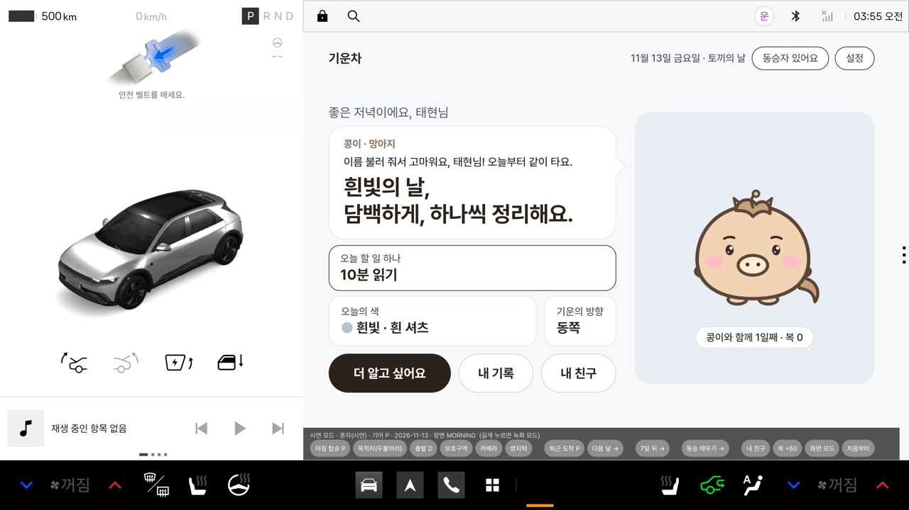

## 시연 영상
- [93초 시연 영상](docs/demo/giuncha_demo_v0.9.mp4) — 플레오스 에뮬레이터에서 실제 앱을 녹화했습니다(한국어 음성 안내·자막). 하루와 일주일은 시연용 단추로 건너뛰고 '달릴 때', '바로 저장'부터 '다음 날 아침'까지, '같이 탄 날'의 첫 화면은 같은 앱의 화면 캡처입니다.
- 키치 모드 화면: [docs/screens/kitsch](docs/screens/kitsch)

## 무엇을 하나요
| # | 장면 | 언제 (차량 신호) | 화면 |
|---|---|---|---|
| 1 | 처음 만남 | 첫 실행 | 부를 이름·생년월일만 → "물 같은 사람 · 말띠" 정체성 카드와 내 띠 친구(말띠면 망아지), 이름 지어 주기 |
| 2 | 오늘의 카드 | **기어 P** (Vehicle SDK) | 친구가 말풍선으로 오늘의 한 줄 + 오늘의 색 · 작은 행동 하나 · 기운의 방향(30초). 원할 때만 옷·갈 곳·사람·좋은 시간 |
| 3 | 오늘의 데스티니 | **내비 목적지 변경** (NaviHelper SDK) | 목적지 방향과 오늘 기운의 방향 (주말·처음 가는 곳만, 점수·나쁜 말 없음) |
| 4 | 출발 | **기어 D** | 멈춘 그림과 큰 글자 한 줄. 터치·소리 없음. 주의 지점·단속 카메라 알림(NaviHelper SDK)이 오면 조심하는 표정과 한 줄이 한 번 바뀜 |
| 5 | 도착 | 달리다가 **기어 P** | 주의 구간을 지나온 날은 '오늘 지나온 길' 한 장. 복은 하루 한 번(운행을 마치면 +10, 한 단어를 남기면 +5) |
| 6 | 퇴근 한 단어 | 저녁에 달리다가 주차(도착) | "오늘 어땠어요?" 한 단어 → 공감 한 줄 + 내일 아침 색 예고. 저녁에 막 탔을 때는 인사만(앱을 늦게 켰으면 [지금 한 단어 남기기]로 바로 남김) |
| 7 | 조금 더 이야기 | 답글 뒤, 주차 중에만 | 마음에 걸린 것 하나 → 미리 써 둔 한 줄 + 작은 행동. 내일 아침에 이어 갈지는 운전자가 고름. 상담·치료가 아님 |
| 8 | 다음 날 | 다음 아침, 기어 P | 어제 고른 감정을 채워 주는 오행으로 오늘의 색·행동이 바뀜 |
| 9 | 7일 쌓임 | 일주일 뒤 | 요일마다 그날의 표정을 한 친구 + 가장 자주 고른 마음. 기록이 7일이면 친구가 자람 |
| 10 | 같이 탄 날 | **좌석 착석 신호** (Vehicle SDK) | 운전석 말고 다른 자리에 누가 앉으면 마음 화면을 가리고 '오늘은 같이 가는 날' → 옆자리는 띠만 골라 오늘의 조합 |
| 11 | 내 친구 · 설정 | 주차 중 | 이름 바꾸기 · 모습 고르기 · 복 150으로 만나는 수호 친구 다섯 / 화면 모드 바꾸기 · 기록 모두 지우기 |

| | | |
|---|---|---|
| 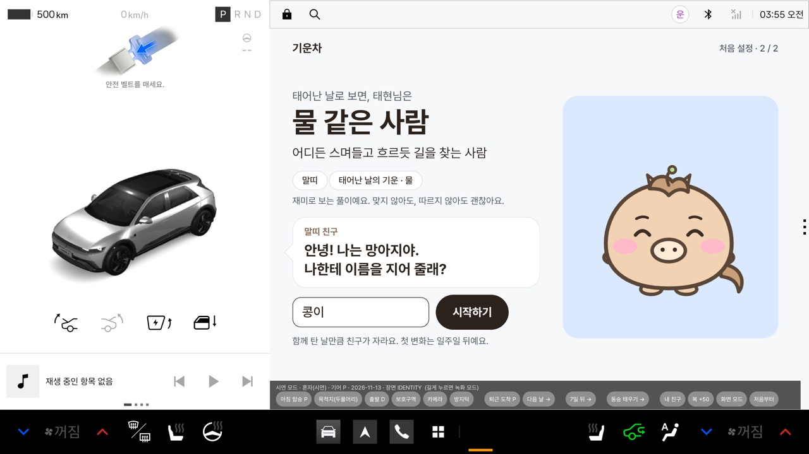 | 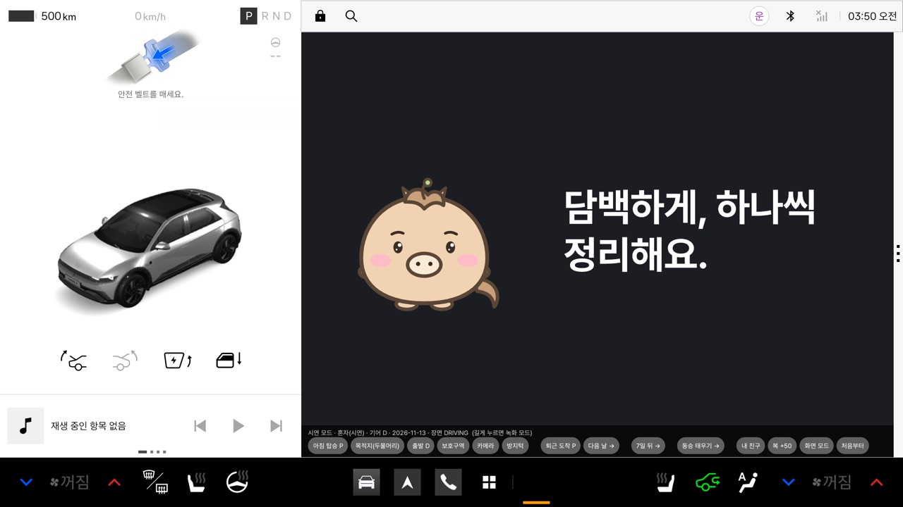 | 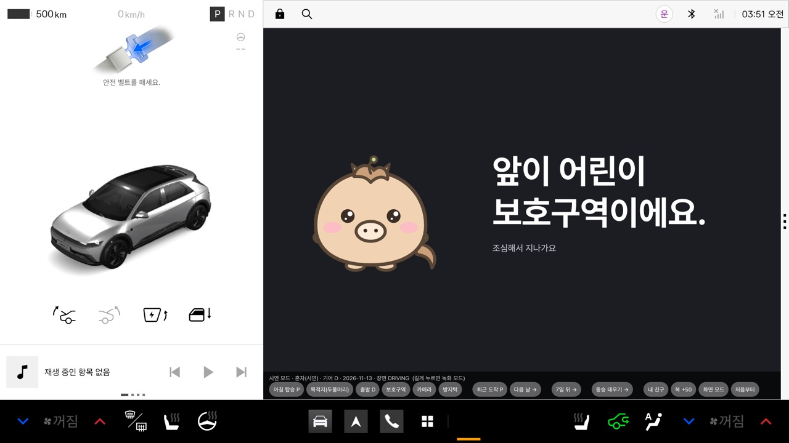 |
| 1 처음 만남 | 4 출발: 멈춘 그림 + 한 줄 | 4 주의 구간: 조심하는 표정 |
| 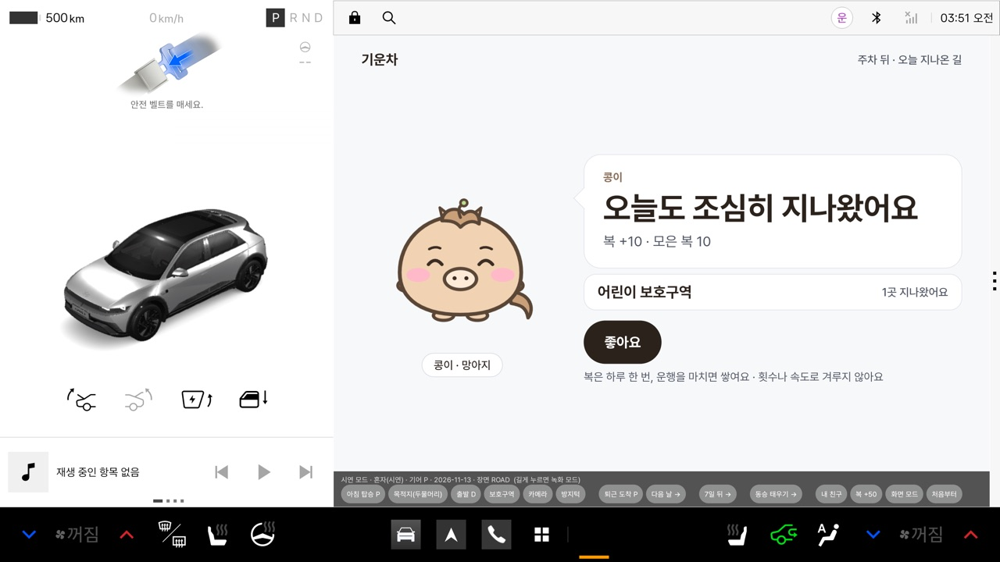 | 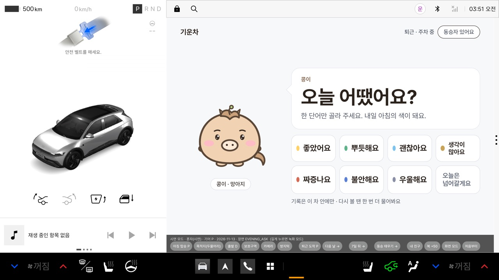 | 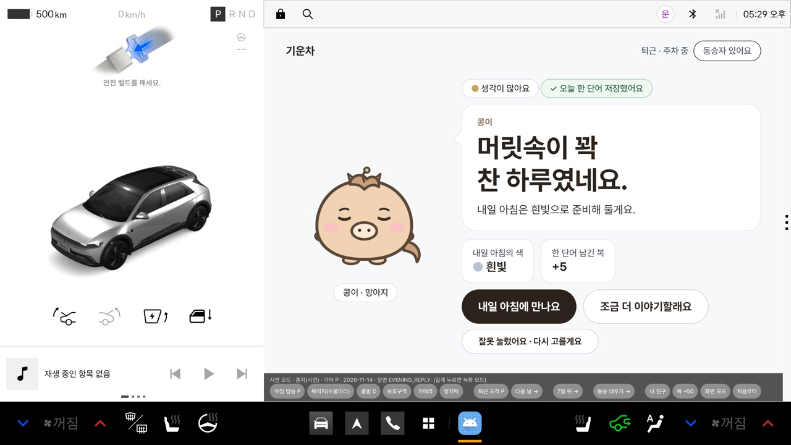 |
| 5 도착: 오늘 지나온 길 | 6 퇴근 한 단어 | 6 공감 한 줄 + 내일 예고 |
| 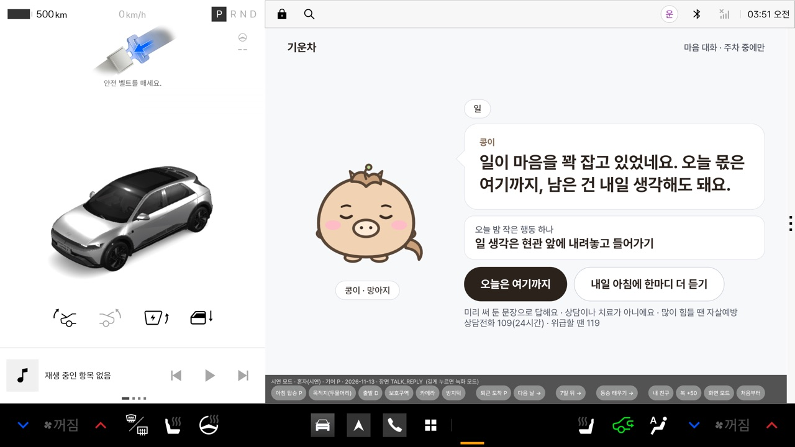 | 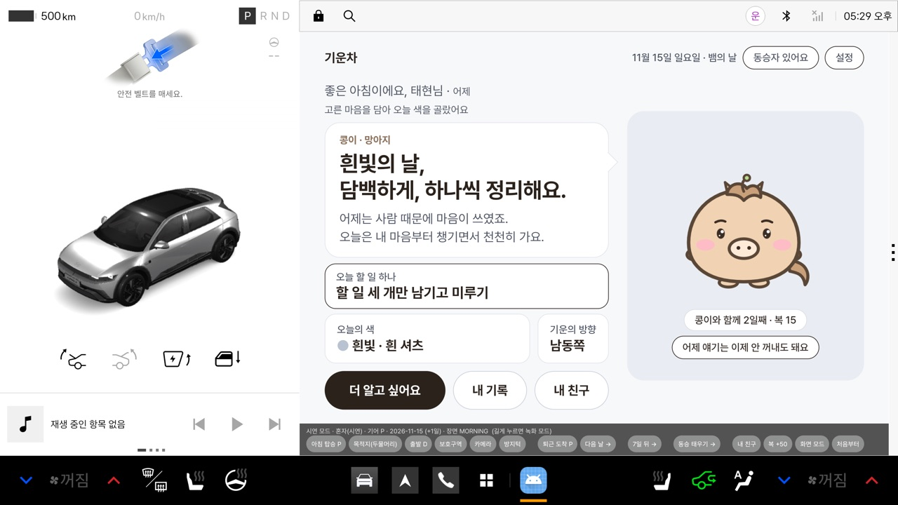 | 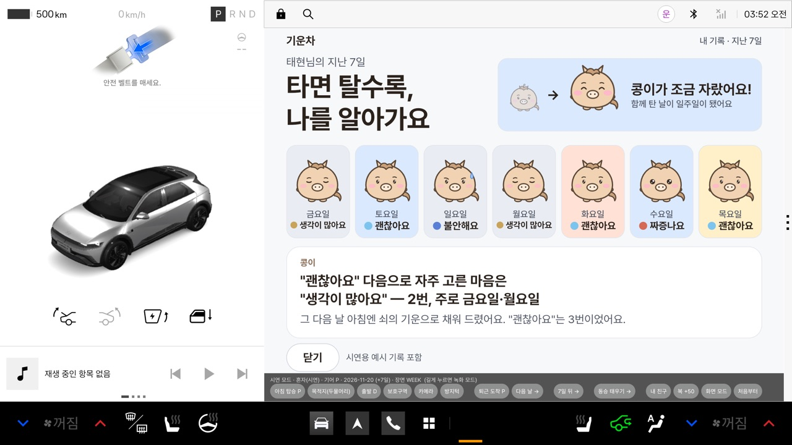 |
| 7 조금 더 이야기 | 8 다음 날 | 9 7일 쌓임, 자란 친구 |
| 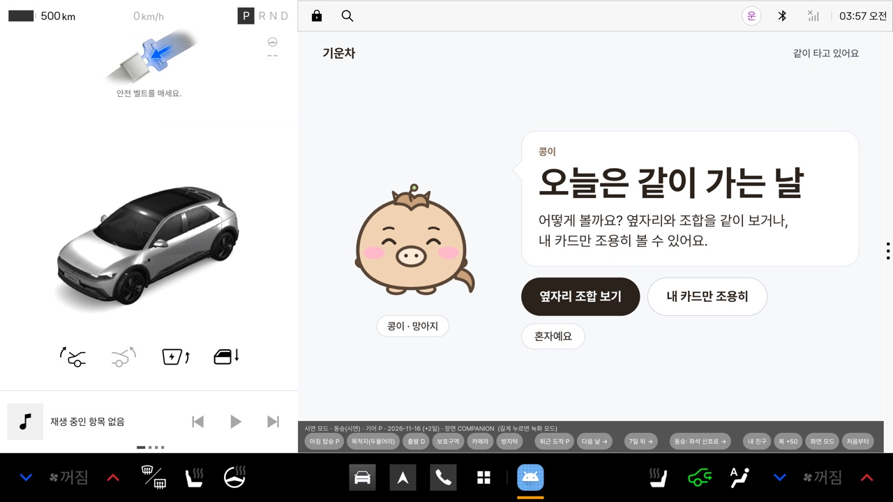 | 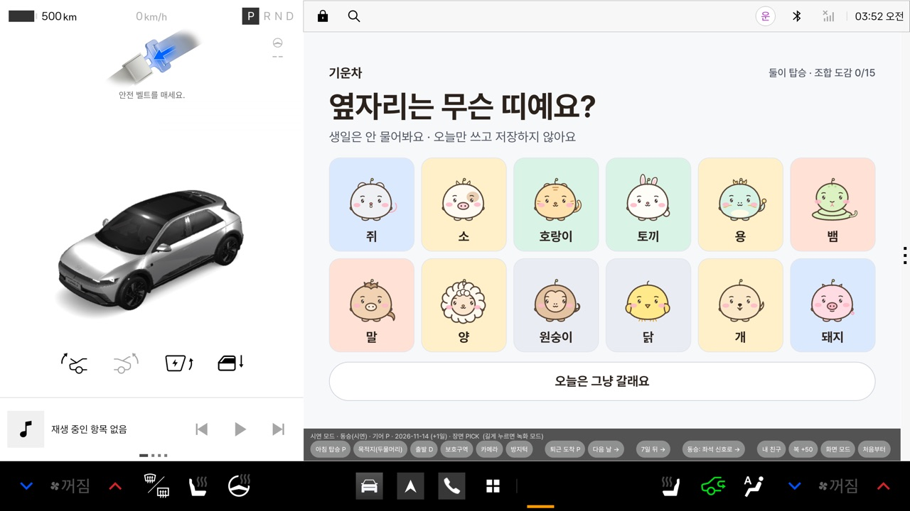 | 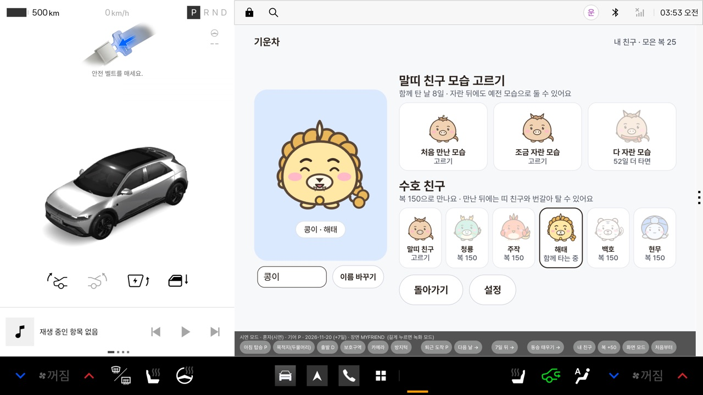 |
| 10 같이 탄 날 | 10 옆자리 띠 고르기 | 11 내 친구 |

## 화면 모드 3가지
계산은 같고 보는 맛만 다릅니다. 오늘의 카드에 있는 **설정**에서 바꿉니다.

| 캐릭터 모드 (기본) | 차분 모드 | 키치 모드 |
|---|---|---|
|  | 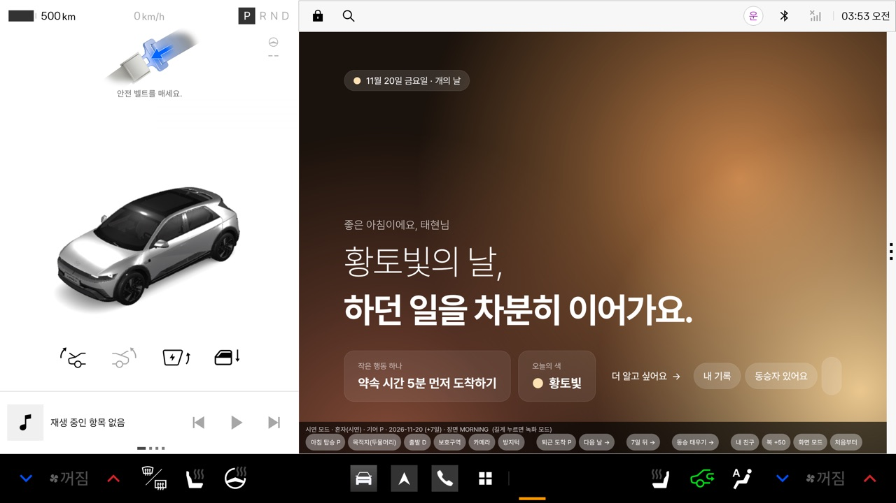 | 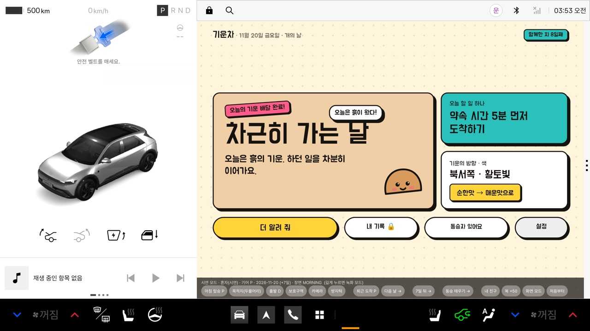 |
| 열두 띠 친구가 말풍선으로 오늘을 알려 줌. 친구 · 복 · 조금 더 이야기는 이 모드의 기능 | 오행별 빛 번짐 배경과 한 줄 | 만화풍. 말투(순한맛 ↔ 매운맛)를 고를 수 있음 |

## 차라서 되는 것
- **기어가 화면을 바꿉니다** — `Vehicle.getGear()`의 `registerGearSelection`. 주차하면 오늘의 카드, 출발하면 한 줄. 달리다가 주차한 것(도착)과 막 탄 것을 구분해 한 단어는 도착했을 때만 묻습니다.
- **내비가 말을 겁니다** — `NaviHelperEventListener`의 `onDestinationChanged`(오늘의 데스티니), `onCautionPointInfo` · `onCameraAlert`(달릴 때 친구 표정).
- **좌석이 사생활을 지킵니다** — `Vehicle.getSeat()`의 `checkSeatOccupancyCapabilities` · `registerSeatOccupancy`. 좌석 신호를 다 받을 때까지는 가린 채로 시작하고 누가 앉으면 마음 화면을 바로 가립니다. 다시 여는 것은 운전자가 **혼자예요**를 눌렀을 때뿐입니다. 좌석 신호가 없는 차는 **동승자 있어요** 단추로 알립니다.

## 같이 탄 사람 앞에서
- 한 단어 묻기, 답글, 조금 더 이야기, 7일 기록은 같이 탄 사람이 있으면 뜨지 않습니다. 동승 중에는 기록을 열 수 없습니다.
- 같이 탄 것을 알아채면(아침이든 저녁이든) 먼저 **어떻게 볼지** 묻습니다: **옆자리 조합 보기** · **내 카드만 조용히** · **혼자예요**. 한 번 고르면 그 탑승 동안은 다시 묻지 않고, 퇴근 도착 때는 인사만 합니다. 차분 모드에서는 조합 화면도 어두운 차분 화면으로 보여 줍니다.
- 아침 카드에서도 어제 마음을 알 수 있는 문장, 이어 가는 한 줄, 쉬어 가는 카드를 가리고 어제 고른 단어를 색에 반영하지 않습니다.
- 답글은 고른 직후 한 번만 보이고 열어 둔 7일 기록은 90초 뒤 닫힙니다. 앱이 화면에서 사라지면 민감한 화면을 접습니다.
- 옆자리에는 띠만 묻고 저장하지 않습니다. "안 맞는 조합"은 없습니다.

## APK
- **`apk/Taehyeon_GIUNCHA_release.apk`** (release 빌드, versionName 0.3.1, 안드로이드 기본 시험용 키로 서명)
- 설치: `adb install -r -g apk/Taehyeon_GIUNCHA_release.apk`

## 테스트 환경
- Pleos Connect Emulator 2.1.0 (Android 14 / API 34, arm64-v8a, 2560×1440), AVD 콜드 부트
- 에뮬레이터 그래픽: `-gpu host` 권장 (소프트웨어 렌더링에선 시스템 UI가 느려질 수 있음)
- 호스트: macOS (Apple Silicon), JDK 17, Android Gradle Plugin 8.5.2, Kotlin 1.9.25
- 플레오스 SDK: `ai.pleos.playground:Vehicle:2.3.2`, `ai.pleos.playground:NaviHelper:3.0.5`
- 권한: `pleos.car.permission.CAR_DRIVE`(기어), `CAR_SEATS`(좌석 착석), `NAVI_ROUTE` · `NAVI_ROUTE_SEARCH`(목적지·주의 지점). 인터넷 권한은 쓰지 않습니다.

## 빌드·실행
```bash
./gradlew assembleRelease
adb install -r -g app/build/outputs/apk/release/app-release.apk
adb shell am start --user 10 -n ai.taehyeon.giuncha/.MainActivity
```
- 플레오스 에뮬레이터 앱은 사용자 10에서 실행됩니다 → 초기화: `adb shell pm clear --user 10 ai.taehyeon.giuncha`

## 시연 모드
에뮬레이터에서 하루와 일주일을 1분 남짓에 보여 주기 위한 장치입니다. **에뮬레이터에서만 보이고 실제 차에서는 숨습니다.**
- 화면 아래 **시연 줄**(하루가 흘러가는 순서): 아침 탑승 P · 목적지(두물머리) · 출발 D · 보호구역 · 카메라 · 방지턱 | 퇴근 도착 P · 다음 날 → | 7일 뒤 → | 동승 | 내 친구 · 복 +50 · 화면 모드 · 처음부터
  - 기어·목적지·주의 지점·좌석은 실제 SDK 리스너로도 처리되며 시연 줄은 같은 처리 함수를 부릅니다
  - 에뮬레이터에서는 내비 주의 지점 신호를 직접 낼 수 없어 "보호구역 · 카메라 · 방지턱" 단추로 같은 경로를 태웁니다
  - 에뮬레이터는 모든 좌석을 '앉음'으로 알려 줍니다. 그래서 시연은 혼자로 시작하고 동승 단추를 누를 때마다 태우기 → 좌석 신호로 → 내리기 → 시연 혼자로 바뀝니다. '내리기'는 실제 차처럼 운전자가 **혼자예요**를 누를 때까지 화면을 가린 채로 둡니다
  - "7일 뒤"는 비어 있는 날만 예시 감정으로 채우고 화면에 "시연용 예시 기록 포함"을 표시합니다
- **녹화 모드**: `adb shell am start --user 10 -n ai.taehyeon.giuncha/.MainActivity --ez rec true` (또는 시연 줄의 상태 글자를 길게 누르기) → 시연 줄을 숨기고 장면 자막을 표시
- 자동 시연 녹화: `scripts/record_demo.sh` — 누를 곳을 화면 글자로 찾아 좌표를 적어 둔 뒤(`--find`) 그 좌표로 녹화합니다(`--record`)

## 구조
```
app/src/main/java/ai/taehyeon/giuncha/
  MainActivity.kt   장면 전환 · 기어/내비/좌석 SDK 연결 · 동승 판단 · 시연/녹화 모드
  Engine.kt         사주 엔진 (일주 기반 · 오행 생극 · 감정→다음 날 색 규칙 ①위기 ②연속 ③감정 ④기본)
  Store.kt          기기 안 저장 (SharedPreferences, 서버 전송 없음)
  Visuals.kt        차분 모드의 빛 번짐 배경 · 구슬 · 데스티니 나침반
app/src/main/assets/
  friend/friend.html   캐릭터 모드 화면(WebView). 열두 띠 친구와 수호 친구 다섯을 그림 파일 없이 코드로 그림
  kitsch/kitsch.html   키치 모드 화면(WebView)
  content.json         문장·색·규칙 사전 (금칙어 목록 포함)
```

## 원칙
- **달릴 땐 운전이 먼저**: 기어 D면 멈춘 그림과 큰 글자 한 줄만, 누를 것도 소리도 없음
- **나쁜 말·점수 없음**: 흉·불운 같은 금칙어 사전, 데스티니는 방향만 안내. 재미로 보는 풀이임을 화면에 적음
- **기록은 차 안에만**: 이름·생년월일·감정 한 단어는 기기 안에만 저장, 외부 전송 없음. 설정에서 모두 지울 수 있음. API 키·계정 정보 없음
- **복은 겨루지 않음**: 하루 한 번씩만 쌓이고 횟수·속도·거리로 늘지 않음. 뽑기·확률·순위·결제 없음
- 불안·우울이 3일 이어지면 사주 처방 없이 쉬어 가는 카드를 띄우고 누르면 도움 연락처(109)를 안내. 불안·우울에는 매운맛 말투를 쓰지 않음
- **문장**: 미리 넣어 둔 문장 사전에서 규칙으로 고름(초안은 AI, 팀이 금칙어·말투 기준으로 골라 넣음)

## 아직 안 된 것 (2단계)
- 조금 더 이야기를 목소리와 AI로 넓히기(지금은 미리 써 둔 문장)
- 실제 차·Virtual Console에서 주의 지점·카메라·좌석 신호 확인
- 달리는 동안 화면을 띄워도 되는지(플레오스 주의 분산 기준)를 실제 차에서 확인
- 내비와 나란히 뜨는 세로 창(840×1184) 배치 — 시안은 `docs/design/04_window_layouts.png`
- 깜빡이·와이퍼·운전 시간을 '오늘 지나온 길'에 더하기, 쉬는 날 가 볼 만한 곳

## 라이선스
- 폰트: Pretendard, Do Hyeon, Jua — SIL Open Font License 1.1 (`licenses/`)
